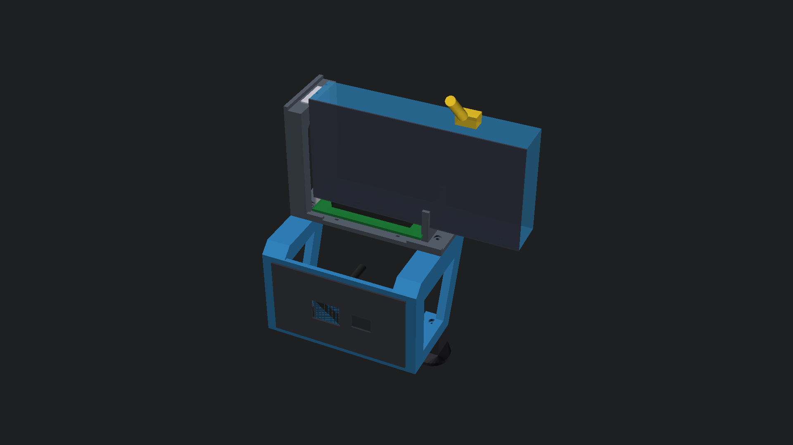

# Support Externe GPU pour ASUS ProArt PA602 (Multi-GPU / AI / Compute)

Support externe 3D paramétrique (OpenSCAD) conçu pour installer proprement et solidement un 3ᵉ GPU à l'arrière d'un boîtier **ASUS ProArt PA602**, ancré directement sur les vis de l'alimentation ATX avec déport ventilé et décharge verticale au sol.



---

## 🎯 Points Forts & Architecture Mécanique

1. **Fixation rigide sur l'alimentation ATX ([`psu_bracket.scad`](psu_bracket.scad)) :**
   - **Empreinte 10 trous universelle** : compatible avec le schéma spécifique du boîtier ASUS ProArt PA602 (inversé gauche-droite) et le standard Intel ATX conventionnel.
   - **Puits de vis intégrés** : lamages creusés pour les têtes de vis 6-32 UNC et dégagements pour tournevis le long des semelles.
   - **Grande baie centrale dégagée ($138 \times 67\text{ mm}$)** : laisse un accès total à la prise secteur 230V (C13/C14/C20), à l'interrupteur I/O et au bouton Zero-Fan du bloc d'alimentation.
   - **Évidements trapézoïdaux latéraux** : allègent la structure tout en épousant l'inclinaison des poutres et en favorisant la circulation d'air.
   - **Rainure de dégagement PCIe ($3{,}5\text{ mm}$)** : creusée sous la fente du riser pour accueillir la pointe des languettes métalliques de l'équerre GPU.

2. **Plateau Riser PCIe & Maintien de la Carte ([`riser_tray.scad`](riser_tray.scad)) :**
   - **Orientation thermique optimale** :
     - Ventilateurs tournés vers l'extérieur (`+Y`) : puisent l'air frais ambiant de la pièce.
     - Backplate orientée vers le boîtier (`-Y`).
     - Déport libre de $60\text{ mm}$ : évite l'échauffement par le flux d'extraction arrière du PC et laisse un espace pour les câbles.
   - **Boutonnières oblongues pour vis de riser M3** : entraxe réglable de **$104\text{ mm}$ à $112\text{ mm}$** (compatible risers PCIe 4.0 et 5.0, validé avec le **Kolink PGW-RC-MRK-010** 90° 300 mm).
   - **Passage de nappe 90° sans contrainte** : fente centrale élargie à $96\text{ mm}$ et nervure arrière interrompue au centre pour laisser la nappe PCIe courir à plat vers les slots du boîtier.
   - **Portique d'équerre PCIe ajouré ($117\text{ mm}$)** : traverse supérieure d'appui de la patte 90° (compatible 2 à 3 slots) et fente inférieure traversante pour les languettes métalliques.
   - **Berceau anti-affaissement (Anti-Sag) surélevé** : maintien calibré à $42\text{ mm}$ d'épaisseur interne (testé avec la **MSI GeForce RTX 5060 Ti 16G VENTUS 2X OC PLUS - V535-005R**).

3. **Reprise de charge verticale ([`support_foot.scad`](support_foot.scad)) :**
   - Deux jambes d'appui sous les semelles inférieures transmettent 100 % du poids du GPU (1,5 à 2,5 kg) au sol/bureau avec logement d'écrou M4 captif, éliminant tout effort de flexion sur la tôle du boîtier.

---

## 📁 Structure du Projet

```text
.
├── config.scad          # Paramètres globaux et tolérances ajustables
├── psu_bracket.scad     # Platine de fixation sur vis ATX et poutres en C
├── riser_tray.scad      # Plateau support riser, portique équerre et berceau
├── support_foot.scad    # Pieds d'appui réglables au sol (écrou M4 captif)
├── assembly.scad        # Modèle 3D complet avec GPU et PSU fantômes
├── print_plates.scad    # Pièces orientées à plat sur plateau (Z >= 0)
├── render_stls.sh       # Script bash de compilation STL binaire et aperçus PNG
├── stl_output/          # Fichiers STL binaires prêts à l'emploi
│   ├── psu_bracket.stl
│   ├── riser_tray.stl
│   └── support_foot.stl
├── previews/            # Rendus de contrôle géométrique
│   ├── assembly_preview.png
│   ├── psu_bracket_preview.png
│   └── riser_tray_preview.png
├── LICENSE              # Licence Creative Commons CC BY-NC-SA 4.0
└── README.md
```

---

## ⚙️ Paramètres Clés ([`config.scad`](config.scad))

Le modèle est 100 % paramétrique. Ouvrez [`config.scad`](config.scad) dans OpenSCAD pour adapter les dimensions si nécessaire :

| Paramètre | Valeur par défaut | Description |
| :--- | :---: | :--- |
| `standoff_depth` | `60 mm` | Déport libre entre le dos du boîtier et le plateau du riser |
| `riser_elevation_from_psu_center` | `60 mm` | Élévation du plateau par rapport au centre de l'alim ATX |
| `psu_receptacle_width` | `138 mm` | Largeur de l'ouverture centrale face alimentation |
| `psu_receptacle_height` | `67 mm` | Hauteur de l'ouverture centrale face alimentation |
| `side_cutout_len_top` | `78 mm` | Longueur haute de la découpe trapézoïdale sur les flancs |
| `side_cutout_len_bot` | `52 mm` | Longueur basse de la découpe trapézoïdale sur les flancs |
| `riser_hole_spacing_x` | `108 mm` | Entraxe nominal des vis de fixation du riser PCB |
| `riser_hole_slot_tol_x` | `2.0 mm` | Tolérance oblongue ($\pm 2\text{ mm}$, plage $104$ à $112\text{ mm}$) |
| `gpu_thickness_mm` | `42 mm` | Écartement intérieur du berceau d'appui anti-sag |
| `pcie_bracket_screw_h` | `117 mm` | Hauteur d'appui de la patte supérieure de l'équerre PCIe |
| `support_foot_height` | `35 mm` | Hauteur des pieds d'appui au sol (ajustable selon garde au sol) |

---

## 🛠️ Quincaillerie Requise (BOM)

- **4× Vis 6-32 UNC (longueur 12 à 16 mm)** : fixation de `psu_bracket` sur l'alimentation ATX.
- **4× Vis M4 × 16 mm + 4× Écrous M4 standard** : assemblage de `riser_tray` sur les semelles supérieures.
- **2× Vis M4 × 25 mm + 2× Écrous M4 standard** : fixation des pieds `support_foot` sous les semelles inférieures.
- **2× Vis M3 × 8 à 10 mm** : fixation du PCB du riser sur ses entretoises oblongues.
- **1× à 3× Vis 6-32 UNC ou M3.5** : blocage de la patte supérieure de l'équerre métallique du GPU.

---

## 🖨️ Conseils d'Impression 3D (FDM)

- **Orientation :** Toutes les pièces dans [`stl_output/`](stl_output/) sont déjà orientées à plat sur la surface d'adhésion optimale (`Z >= 0`).
- **Supports :** **ZÉRO support requis** sur l'ensemble des 3 pièces (tous les angles et goussets sont conçus à $\le 45^\circ$).
- **Matériau recommandé :** **PETG**, **ABS** ou **ASA** (le PLA standard est déconseillé près des sorties d'air chaud de l'alimentation et du GPU pour éviter le fluage thermique sous contrainte).
- **Parois (Perimeters) :** 4 à 5 contours (buse standard 0.4 mm).
- **Remplissage (Infill) :** 30 % à 40 % (Gyroid ou Cubic).

---

## 📜 Licence

Ce projet est distribué sous licence **Creative Commons Attribution - Pas d’Utilisation Commerciale - Partage dans les Mêmes Conditions 4.0 International (CC BY-NC-SA 4.0)**.
